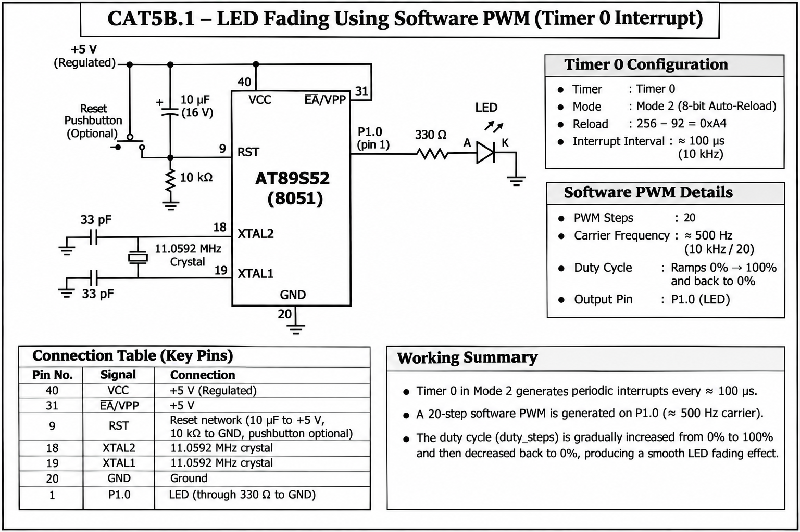

# EXPERIMENT DETAILS

**EXP:** CONTINUOUS ASSESSMENT 5 (CAT5)

**DATE:** 10/08/2026

**NAME OF EXP:** Hardware Timer and Interrupt-Based Timing for LED Fading, Pulse Generation, and Stepper Motor Control

**HARDWARE SETUP / PLATFORM:** AT89S52 (11.0592 MHz) + Keil C51 µVision

---

## TASK 5B.1 – LED FADING USING SOFTWARE PWM

### 1. Hardware Setup

- **Microcontroller:** AT89S52
- **Crystal Frequency:** 11.0592 MHz
- **PWM Output Pin:** P1.0
- **LED Connection:** P1.0 connected to an LED through a 330 Ω resistor
- **Timer:** Timer 0, Mode 2 (8-bit auto-reload)
- **Timer Interrupt Interval:** Approximately 100 µs
- **PWM Carrier Frequency:** Approximately 500 Hz
- **Software:** Keil C51 µVision

### 2. Circuit Diagram

### 3. Objective

- Configure Timer 0 in Mode 2 to generate periodic interrupts.
- Implement software PWM using the Timer 0 interrupt service routine.
- Gradually vary the LED brightness by changing the PWM duty cycle.
- Produce a smooth fading effect by increasing and decreasing the duty cycle.

### 4. Working Principle

Timer 0 generates interrupts at approximately 100 µs intervals. A 20-step software counter is used to generate a PWM signal with an approximate carrier frequency of 500 Hz.

The duty cycle is gradually increased from 0% to 100% and then decreased back to 0%. This repeated variation in duty cycle changes the average power delivered to the LED, producing a fading effect.

### 5. Core Logic / Algorithm

1. Configure Timer 0 in Mode 2 (8-bit auto-reload).
2. Load the timer reload value to obtain an interrupt interval of approximately 100 µs.
3. Enable the Timer 0 interrupt using ET0.
4. Enable global interrupts using EA.
5. Start Timer 0 using TR0.
6. Increment `pwm_tick` modulo 20 inside the Timer 0 interrupt service routine.
7. Set P1.0 HIGH when `pwm_tick < duty_steps`; otherwise, set it LOW.
8. After every 500 timer interrupts, update the duty cycle.
9. Increase `duty_steps` up to 20, then decrease it back to 0.
10. Repeat continuously to create the LED fading effect.

### 6. Code Base

- Timer 0 Mode 2 provides automatic timer reload.
- The Timer 0 interrupt service routine generates the software PWM signal.
- The variable `pwm_tick` tracks the PWM position.
- The variable `duty_steps` controls the LED brightness by determining the PWM duty cycle.

**Build Note:** Rebuild `TASK5B_1.uvproj` in Keil µVision (C51) to regenerate `Objects/TASK5B_1.hex` before programming the AT89S52.

### 7. Inference

Software PWM was implemented using Timer 0 interrupts. By varying the duty cycle from 0% to 100% and then back to 0%, the LED brightness changes gradually, demonstrating timer-based interrupt handling and PWM generation using the AT89S52.
