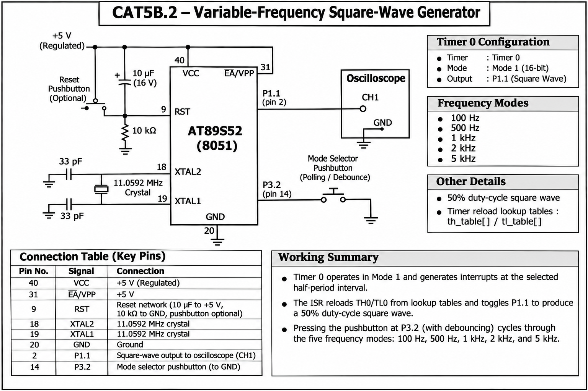

# EXPERIMENT DETAILS

**EXP:** CONTINUOUS ASSESSMENT 5 (CAT5)

**DATE:** 10/08/2026

**NAME OF EXP:** Hardware Timer and Interrupt-Based Timing for LED Fading, Pulse Generation, and Stepper Motor Control

**HARDWARE SETUP / PLATFORM:** AT89S52 (11.0592 MHz) + Keil C51 µVision + Oscilloscope

---

## TASK 5B.2 – VARIABLE-FREQUENCY SQUARE-WAVE GENERATOR

### 1. Hardware Setup

- **Microcontroller:** AT89S52
- **Crystal Frequency:** 11.0592 MHz
- **Signal Output Pin:** P1.1
- **Output Monitoring:** Oscilloscope Channel 1
- **Mode Selector Button:** P3.2
- **Timer:** Timer 0, Mode 1 (16-bit timer mode)
- **Frequency Modes:** 100 Hz, 500 Hz, 1 kHz, 2 kHz, and 5 kHz
- **Software:** Keil C51 µVision

### 2. Circuit Diagram

### 3. Objective

- Generate a square wave using Timer 0 interrupts.
- Select different output frequencies using a lookup table of timer reload values.
- Maintain an approximately 50% duty cycle.
- Change the output frequency using a push button connected to P3.2.

### 4. Working Principle

Timer 0 is configured in Mode 1 to generate interrupts at intervals corresponding to half the selected output period. At every interrupt, the timer is reloaded using the selected values from the lookup tables, and the output pin P1.1 is toggled.

The push button connected to P3.2 is polled by the program. Each valid button press advances the frequency mode through the five available options.

### 5. Core Logic / Algorithm

1. Precompute the 16-bit Timer 0 reload values for all five frequency modes.
2. Configure Timer 0 in Mode 1.
3. Enable the Timer 0 interrupt.
4. In the Timer 0 interrupt service routine:
   - Reload TH0 and TL0 using the values for the selected frequency mode.
   - Toggle the P1.1 output pin.
5. Poll the mode selector button connected to P3.2.
6. Debounce the button input to avoid registering a single press multiple times.
7. On a valid press, increment `freq_mode` modulo 5.
8. Continue generating the square wave at the newly selected frequency.

### 6. Code Base

- `th_table[]` stores the high-byte timer reload values.
- `tl_table[]` stores the low-byte timer reload values.
- `freq_mode` selects the active frequency.
- Lookup tables provide the timer reload values without requiring runtime division inside the interrupt service routine.

**Build Note:** Rebuild `TASK5B_2.uvproj` in Keil C51 µVision to regenerate `Objects/TASK5B_2.hex` before programming the AT89S52 board.

### 7. Inference

A variable-frequency square wave is generated using Timer 0 in Mode 1. The timer reload lookup tables allow the output frequency to be selected from 100 Hz, 500 Hz, 1 kHz, 2 kHz, and 5 kHz. The output on P1.1 maintains an approximately 50% duty cycle, and the frequency is changed using the mode selector button connected to P3.2.
