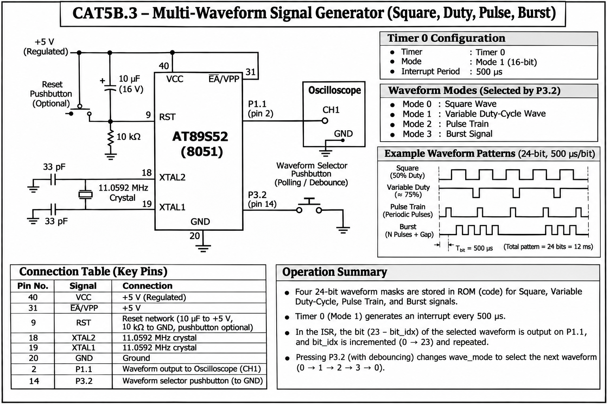

# CAT5 — CONTINUOUS ASSESSMENT 5

**Date:** 10/08/2026  
**Experiment:** 5B.3 — Multi-Waveform Signal Generator  
**Platform:** AT89S52 · 11.0592 MHz · Keil C51 µVision · Oscilloscope

---

## 1. Experiment Overview

This experiment generates four types of digital waveforms through a single output pin:

- Square wave
- Variable duty-cycle wave
- Pulse train
- Burst signal

A 24-bit pattern represents each waveform. Timer 0 controls the timing of the output, while a pushbutton selects which pattern is transmitted.

## 2. Hardware Interface

| Component | Connection / Configuration |
|:--|:--|
| Microcontroller | AT89S52 |
| Clock frequency | 11.0592 MHz |
| Waveform output | P1.1 |
| Output monitoring | Oscilloscope, Channel 1 |
| Waveform selector | Pushbutton on P3.2 |
| Timer | Timer 0 |
| Timer interrupt interval | 500 µs |

## 3. Circuit Diagram

## 4. How the Waveform Generation Works

The program stores four 24-bit waveform masks in a ROM array named `waveforms[4]`. The selected mask is transmitted one bit at a time through P1.1.

Timer 0 generates an interrupt every 500 µs. During each interrupt, the program:

1. Reads the bit at position `23 - bit_idx` from the currently selected waveform mask.
2. Writes that bit to P1.1.
3. Advances `bit_idx` so the next interrupt outputs the next bit.

The sequence starts at the most significant bit. The waveform selector on P3.2 changes the active pattern, allowing the same timer-driven output mechanism to generate all four waveform types.

## 5. Program Flow

1. Define the four 24-bit waveform patterns in the ROM array `waveforms[4]`.
2. Initialize the waveform selection and bit-position variables.
3. Configure Timer 0 for a 500 µs interrupt interval.
4. Enable the Timer 0 interrupt and start the timer.
5. In the interrupt service routine, output the selected pattern's current bit to P1.1.
6. Increment `bit_idx` to advance through the 24-bit pattern.
7. Monitor the P3.2 pushbutton and debounce each press.
8. Update `wave_mode` to select the next waveform.
9. Continue transmitting the selected waveform pattern.

## 6. Important Program Variables

| Variable | Purpose |
|:--|:--|
| `waveforms[4]` | Stores the four 24-bit waveform patterns |
| `bit_idx` | Tracks the bit currently being output |
| `wave_mode` | Selects the active waveform pattern |

A parameterized Timer 0 interrupt service routine is used for all four waveform modes; the selected pattern determines the output sequence.

## 7. Build and Output

Rebuild `TASK5B_3.uvproj` in Keil C51 µVision to generate:

`Objects/TASK5B_3.hex`

Observe the signal at P1.1 using Oscilloscope Channel 1. Use the pushbutton connected to P3.2 to switch between the four waveform modes.

## 8. Inference

The experiment demonstrates how a sequence of stored digital bits can be serialized onto a single GPIO pin using timer interrupts. By changing the selected 24-bit pattern, the AT89S52 generates square-wave, variable-duty-cycle, pulse-train, and burst outputs through the same P1.1 signal line.
